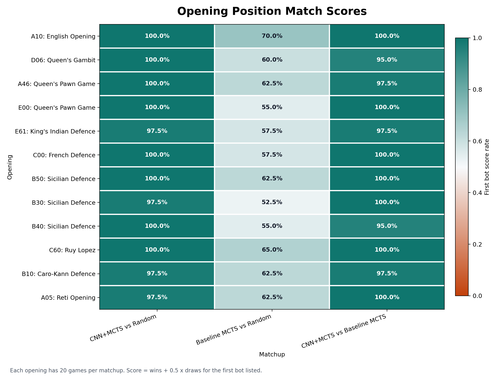
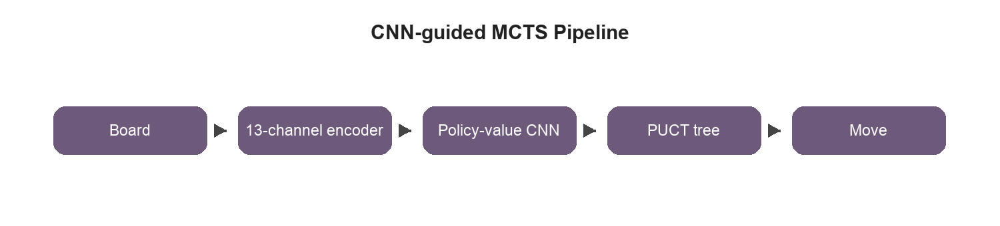

# CNN-Guided Monte Carlo Tree Search Chess Engine


An experimental chess engine developed as a graduation project. It combines a
supervised convolutional policy-value network with Monte Carlo Tree Search
(MCTS), then compares the hybrid engine against a rollout-based MCTS baseline
and a random legal-move agent.

The repository includes the source code, best trained checkpoint, balanced
experiment runner, final results, generated figures, a terminal game, and a
Lichess bot client.

## Highlights

- Shared residual CNN with policy and value heads
- PUCT-guided tree search with policy priors
- CNN value evaluation instead of random rollouts
- Repetition-aware final move selection
- Balanced colors across standard and opening-position experiments
- MPS, CUDA and CPU device selection
- Included 14 MB best model checkpoint for immediate inference
- A 1,020-game experiment across three matchups and 12 opening positions

## Results

The main standard-start experiment used 100 games per matchup with colors
alternated evenly.

| Matchup | First bot wins | Second bot wins | Draws | First bot score |
|---|---:|---:|---:|---:|
| CNN + MCTS vs Random | 98 | 0 | 2 | 99.0% |
| Baseline MCTS vs Random | 32 | 7 | 61 | 62.5% |
| CNN + MCTS vs Baseline MCTS | 97 | 0 | 3 | 98.5% |

The complete aggregate summaries and 983 recovered per-game records are
available in [`results/final`](results/final). The first 37 standard-start
game log entries were unavailable during log recovery; their aggregate counts
remain present in `summary.csv` and `summary.json`. Historical result files use the label
`Vanilla MCTS`; this is the same agent referred to as `Baseline MCTS` here.



> These results measure the agents under this project's implementation and
> settings. They are not an Elo estimate and should not be compared directly
> with production chess engines.

## Architecture

The board is encoded as a `13 × 8 × 8` tensor: 12 piece planes and one
side-to-move plane. A shared CNN backbone contains a convolutional stem and
three 128-channel residual blocks. Its two heads produce:

- **Policy:** logits over a 20,480-action from/to/promotion encoding
- **Value:** a `tanh`-bounded position estimate in `[-1, 1]`



At each search node, CNN + MCTS selects actions with a PUCT-style score:

```text
PUCT(s, a) = Q(s, a) + c_puct · P(s, a) · sqrt(N(s) + 1) / (1 + N(s, a))
```

The baseline instead uses UCB-style selection and estimates leaf positions by
playing random legal moves to a terminal state.

## Repository layout

```text
.
├── bots/                   Random, baseline MCTS and CNN + MCTS agents
├── cnn/                    Encoding, model, data pipeline, training, inference
│   └── data/               PGN filtering and dataset construction
├── core/                   Search-tree node implementations
├── docs/assets/            Selected dataset-analysis figures
├── matches/                Games, benchmarks and experiment suite
├── models/                 Included best policy-value checkpoint
├── results/
│   ├── final/              Per-game and aggregate experiment data
│   └── figures/            Generated plots and architecture diagrams
├── tools/
│   └── experiments/        Result recovery and visualization utilities
├── inspect_position.py     Position-level search diagnostics
└── lichess_bot.py          Lichess Bot API client
```

Large/raw artifacts are intentionally excluded: the PGN training corpus,
virtual environments, intermediate checkpoints, raw logs, generated working
directories, credentials, and third-party papers.

## Quick start

Python 3.10 or newer is recommended.

```bash
git clone https://github.com/erenosym/cnn-mcts-chess-engine.git
cd cnn-mcts-chess-engine

python3 -m venv .venv
source .venv/bin/activate
python -m pip install --upgrade pip
python -m pip install -r requirements.txt
```

The best model is already located at
`models/chess_policy_value_model_best.pt`.

Play against CNN + MCTS in the terminal:

```bash
python -m matches.play_vs_cnn_mcts
```

Inspect a FEN position and print the leading candidates:

```bash
python inspect_position.py "rnbqkbnr/pppp1ppp/8/4p3/4P3/8/PPPP1PPP/RNBQKBNR w KQkq - 0 2"
```

See every diagnostic option with:

```bash
python inspect_position.py --help
```

## Experiments

List the 12 configured opening positions without playing games:

```bash
python -m matches.experiment_suite --list-openings
```

Run the complete balanced suite:

```bash
python -m matches.experiment_suite
```

Useful smaller runs:

```bash
# Fast standard-start smoke run
python -m matches.experiment_suite \
  --standard-only \
  --standard-games 2 \
  --simulations 10

# One matchup over a subset of opening positions
python -m matches.experiment_suite \
  --openings-only \
  --matchups cnn_mcts-mcts \
  --opening-start 1 \
  --opening-end 3 \
  --opening-games 2
```

By default, generated CSV and JSON files are written under
`analysis_outputs/experiments/`, which is ignored by Git. Curated final results
live in `results/final/`.

## Training

The training pipeline expects the January 2025 Lichess Elite PGN at the project
root:

```text
lichess_elite_2025-01.pgn
```

Download the corpus from the
[Lichess Elite Database](https://database.nikonoel.fr/) and then run:

```bash
python -m cnn.train
```

Training samples use the played move as the policy target and the final game
result as the value target. Positions are sampled every three plies, capped at
24 samples per game. Games ending by time forfeit, abandonment, or rules
infractions are filtered out. The split is performed at game level to prevent
positions from one game leaking across training and evaluation sets.

The objective is:

```text
L_total = L_policy + L_value
L_policy = cross_entropy(label_smoothing=0.08)
L_value  = mean_squared_error
```

Both losses have weight `1.0`. Training writes its checkpoints to `models/`.
Only the best checkpoint is versioned.

## Lichess bot

Create a dedicated Lichess bot token, then provide it through an environment
variable. Never place tokens in source files.

```bash
export LICHESS_BOT_TOKEN="your_new_token"
python lichess_bot.py
```

The client accepts standard chess challenges, follows game event streams, and
serializes model inference with a lock so multiple game threads do not access
the evaluator concurrently.

## Reproducing figures

```bash
python tools/experiments/visualize_experiment_results.py \
  --summary results/final/summary.csv \
  --games results/final/game_results.csv \
  --output-dir analysis_outputs/visualizations
```

Run `--help` to see additional subsets and path options.

## Data and model notes

- The Lichess Elite PGN is not committed because of its size and upstream
  distribution model.
- The supplied checkpoint is intended for research and project demonstration.
- Randomized move selection and stochastic data sampling can affect exact
  reproduction unless random seeds and runtime settings are controlled.
- Experiment outputs record the configuration used by the project; review the
  command-line defaults before making new comparisons.

## Acknowledgements

- [python-chess](https://python-chess.readthedocs.io/) for board rules and PGN
  parsing
- [PyTorch](https://pytorch.org/) for model training and inference
- [Lichess Elite Database](https://database.nikonoel.fr/) for the filtered
  public-game corpus used locally during training
